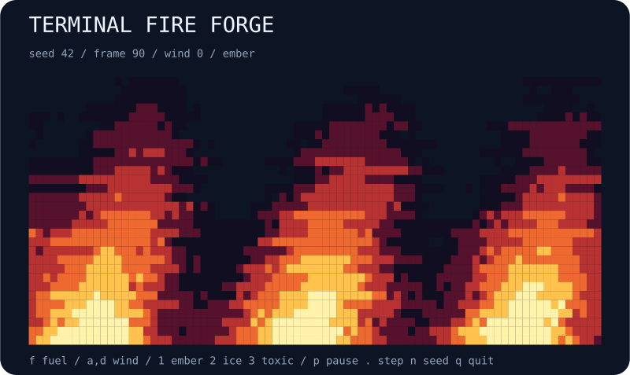

# terminal-fire-forge

A seeded terminal fire playground with wind, fuel, and three color palettes.



## Run

```bash
npx --yes github:b69ca/terminal-fire-forge
```

Node.js 20 or newer. Zero runtime dependencies. Everything runs locally.

## Play

| Key | Action |
| --- | --- |
| `p` / Space | Pause or resume automatic updates |
| `.` | Pause and advance one step |
| `n` | Start the next seed |
| `r` | Reset the current seed |
| `+` / `-` | Faster or slower display |
| `q` / Ctrl-C | Quit and restore the terminal |

`--wind N` selects an integer from −2 to 2 (default 0). `a` / `d` decrease / increase wind. `f` toggles fuel. `--palette ember|ice|toxic` chooses the initial palette; `1`, `2`, `3` switch live. Reset and next seed restore the startup settings.

A live session uses an alternate screen and restores the cursor and input mode on exit. `--no-color` and `NO_COLOR=1` disable ANSI colors. Dimensions fit the terminal at startup; very small terminals may clip the minimum grid. Pass explicit dimensions to reproduce a snapshot across terminals.

## Export

```bash
npx --yes github:b69ca/terminal-fire-forge --seed 42 --steps 90 --svg preview.svg
npx --yes github:b69ca/terminal-fire-forge --seed 42 --steps 90 --json
npx --yes github:b69ca/terminal-fire-forge --frames 100
```

Common flags: `--seed N` (0–4294967295), `--width N` (20–120), `--height N` (10–60), `--steps N` (0–10000), `--frames N` (0–100000), `--json`, `--svg FILE`, `--no-color`, and `--help`.

Live mode starts at step zero. Exports and piped output default to 90 steps; `--steps` overrides that. JSON and SVG can be combined; neither accepts `--frames`. Piped output shows at most one plain frame with no ANSI escapes. Live frames show the starting state first and advance between frames; paused frames still count toward a finite frame limit. Exit codes: 0 success, 2 argument or file error.

## How it works

A seeded heat field propagates upward one row per tick. Each cell samples a jittered, wind-shifted weighted average from the row below, then cools by a small random amount. Horizontal sampling wraps at the edges. A pulsing heat source feeds the bottom row; turning fuel off removes that source and the remaining heat rises and disappears. Two buffers make each update synchronous. Values stay between zero and one. Palette changes affect only appearance. This is retro procedural fire art, not a combustion or fluid-dynamics model. JSON summarizes heat, lit cells, fuel, wind, and palette rather than exporting the full grid.

## Library

Install with `npm install github:b69ca/terminal-fire-forge`, then:

```js
import { createWorld, step, analyze, renderSVG } from 'terminal-fire-forge';
const world = createWorld({ seed: 42, width: 80, height: 30 });
step(world, 90); // Mutates and returns the world.
console.log(analyze(world));
const svg = renderSVG(world);
```

Renderers and `step` accept states created by `createWorld`. Do not change dimensions or replace internal arrays. The library also exports `palettes`; `world.fuel`, `world.wind` (integer −2 to 2), and `world.palette` may be changed to supported values between steps.

## Development

```bash
npm ci
npm run check
```

Tests check determinism, incremental updates, model invariants, validation, rendering, CLI errors, and file exports. CI runs Node.js 20, 22, and 24.

## License

MIT
